<div align="center">

# Annuaire d'étudiants
### Trois structures de données, un seul verdict : **les mesures**

*Mini-projet A — Algorithmique et Complexité · 2ème année Ingénieur · Université Abderrahmane Mira de Béjaïa · 2026/2027*


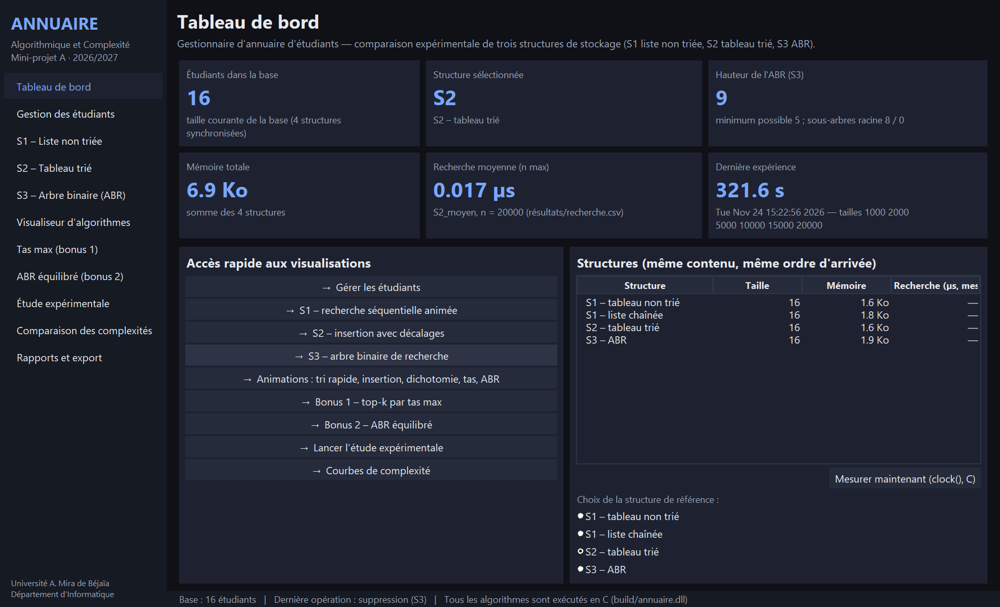

</div>

---

## En une phrase

Une base d'étudiants gérée **en parallèle** par trois structures (liste non triée, tableau trié, arbre binaire de recherche), écrites **intégralement en C**, comparées par une **vraie étude expérimentale** (31 courbes, des milliers de mesures) et **animées pas à pas** dans une interface graphique qui rejoue l'exécution réelle du code C.

> **Ce n'est pas qu'un gestionnaire d'étudiants** : c'est un laboratoire pour *voir* pourquoi un ABR dégénéré devient 4 700 fois plus lent qu'un ABR équilibré, ou pourquoi le tri rapide à pivot fixe s'effondre sur des données triées.

---

## Les résultats en un coup d'œil

Mesures réelles à **n = 20 000 étudiants** (`clock()`, `-O2`, moyenne de 3 simulations — détail dans [`resultats/`](resultats)) :

| Opération | S1 tableau | S2 trié | S3 ABR | Gagnant |
|---|---:|---:|---:|:---:|
| **Ajout** (µs) | **0,051** | 19,35 | 0,43 | S1 |
| **Recherche, moyenne absente** (µs) | 32,5 | 0,029 | **0,013** | S3 / S2 |
| **Suppression** (µs) | 50,5 | 34,3 | **0,35** | S3 (×145) |
| **Affichage trié** (ms) | 3,42 | **0,138** | 0,396 | S2 |
| **Top-10** (µs) | 4 032 | **0,032** | 0,065 | S2 / S3 |

### Les pires cas, mesurés

| Expérience | Cas favorable | Pire cas | Écart |
|---|---:|---:|---:|
| ABR : recherche | 0,015 µs (équilibré) | 72,6 µs (**dégénéré**) | **×4 756** |
| ABR : construction de 20 000 moyennes triées | 2,5 ms (milieu d'abord) | 2 176 ms (insertions croissantes) | **×876** |
| ABR : hauteur | **15** | **20 000** (un peigne) | — |
| Tri rapide de S1 sur données triées | 1,3 ms (pivot médian de 3) | 875 ms (pivot = dernier) | **×667** |
| Top-10 par tas max vs tri complet (S1) | 1 316 µs | 4 032 µs | **×3,1** |

<div align="center">
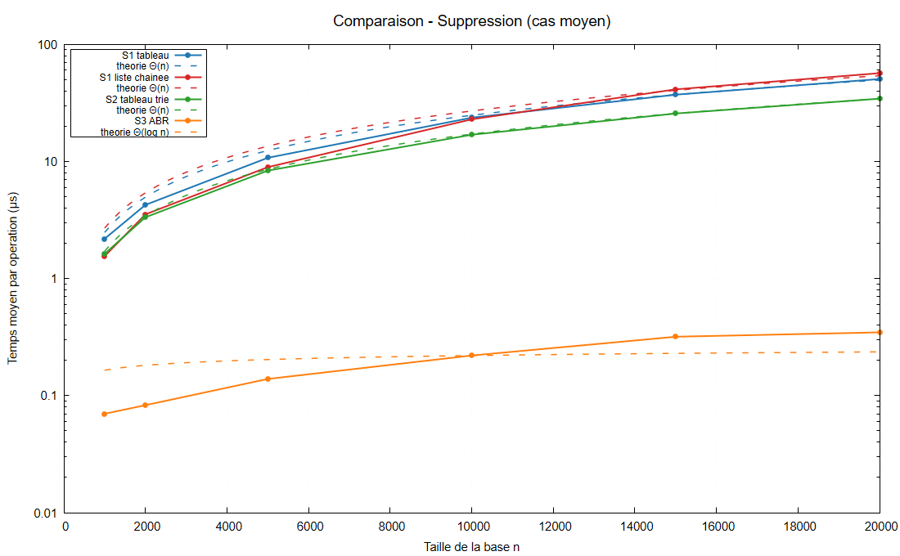 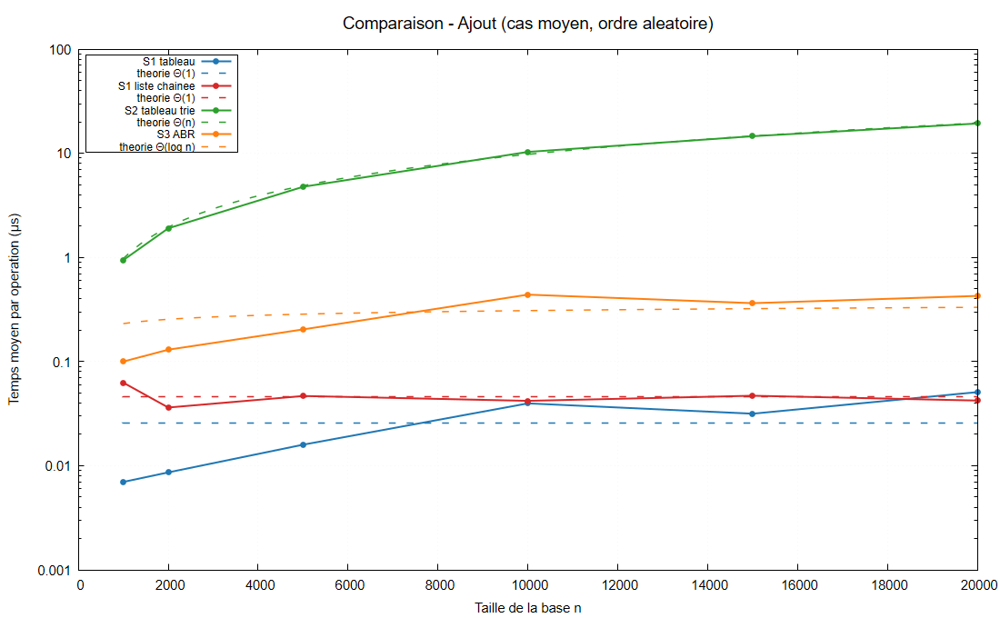
<br><sub>Suppression et ajout : S1 / S2 / S3 sur le même graphe (échelle log). Traits pleins = mesures ; pointillés = complexité théorique ajustée.</sub>
</div>

---

## Ce que contient le projet

### Les trois structures (toutes les fonctionnalités sur chacune)

| | Structure | Idée clé | Complexités |
|---|---|---|---|
| **S1** | Liste non triée | **tableau dynamique** (retenu) + **liste chaînée** pour mesurer l'effet du choix | ajout Θ(1) · recherche Θ(n) · tri Θ(n log n) |
| **S2** | Tableau trié | insertion par décalage (principe du tri par insertion), **dichotomie**, comptage par 2 bornes | ajout Θ(n) · recherche Θ(log n) · top-k Θ(k) |
| **S3** | ABR | **clé composée (moyenne, matricule)**, 3 cas de suppression, opérations 100 % itératives | tout Θ(h) · top-k Θ(h + k) |

### Les trois bonus

- **Bonus 1 — Top-k par tas max** : `entasser`, `construire_tas_max`, extractions. Comparé aux trois autres méthodes sur un graphique unique.
- **Bonus 2 — ABR équilibré** : milieu d'abord, puis récursivement chaque moitié, avec `inserer_abr()`. Hauteur **15** au lieu de **20 000**.
- **Bonus 3 — Interface graphique animée** : 11 sections, thème sombre, animations pilotées par le vrai code C.

---

## L'interface : voir les algorithmes *vraiment* s'exécuter

> Les animations **ne sont pas des simulations Python**. Les fonctions C émettent, pendant leur exécution, une trace d'événements (comparaison, échange, décalage, pivot, nœud visité…) que l'interface rejoue. Ce que vous voyez, c'est ce que le C a fait.

<table>
<tr>
<td width="50%">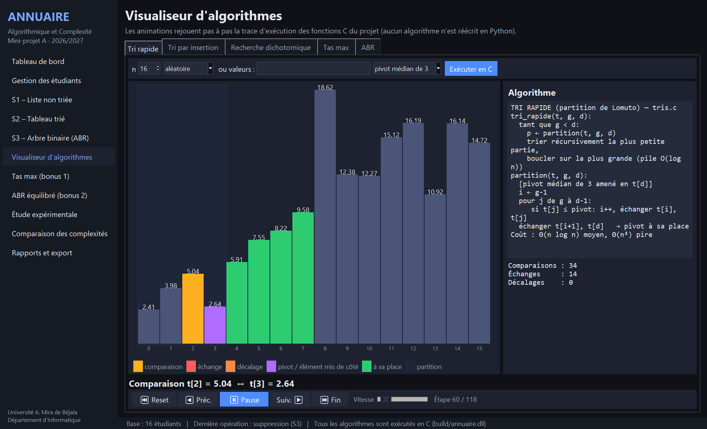<br><sub><b>Tri rapide</b> — pivot, partition, échanges, éléments à leur place définitive.</sub></td>
<td width="50%">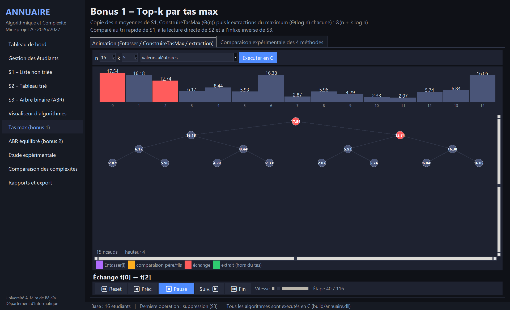<br><sub><b>Tas max</b> — le même tas affiché en tableau <i>et</i> en arbre ; Entasser, ConstruireTasMax, extraction.</sub></td>
</tr>
<tr>
<td>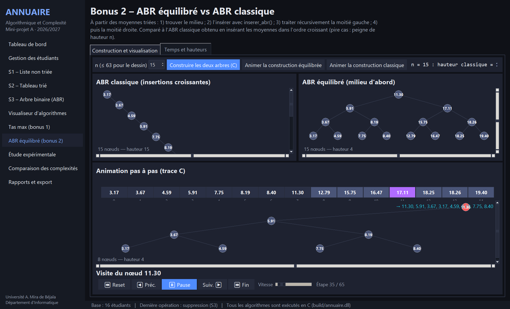<br><sub><b>ABR équilibré</b> — le peigne de l'insertion croissante face à l'arbre construit par le milieu.</sub></td>
<td>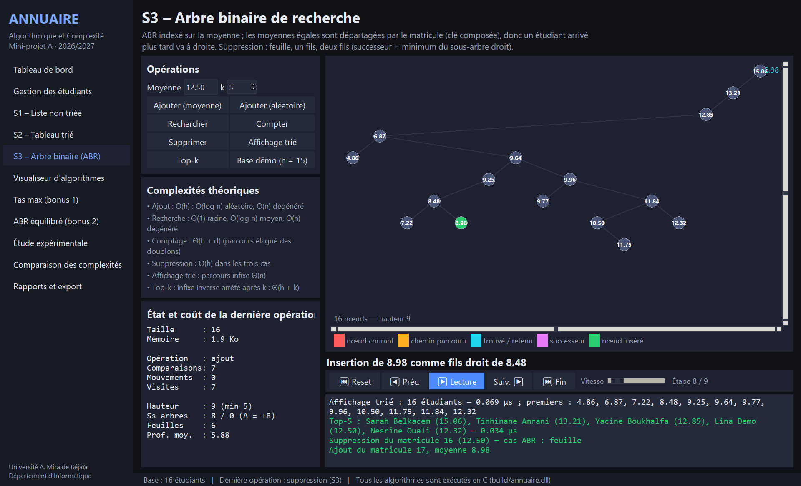<br><sub><b>S3</b> — insertion, recherche, successeur lors d'une suppression à deux fils.</sub></td>
</tr>
</table>

**Commandes d'animation :** lecture, pause, étape suivante, étape précédente, reset, vitesse réglable.

**Visualiseur :** tri rapide · tri par insertion · dichotomie (g / m / d) · tas max · ABR (insertion, recherche, comptage, **les 3 cas de suppression**, top-k).

<div align="center">
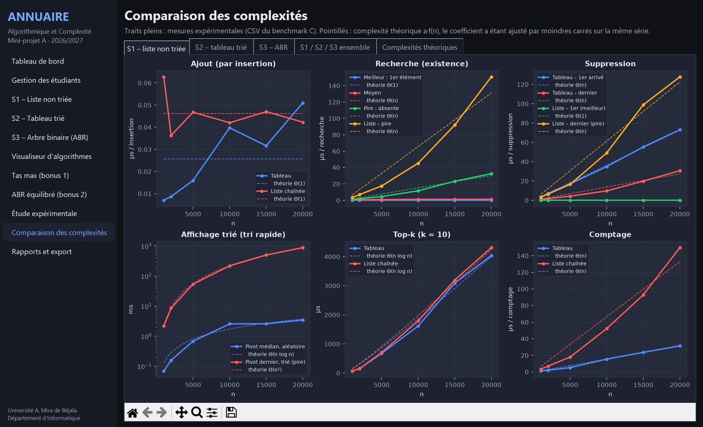
<br><sub>Un tableau de bord de complexité par structure, plus un onglet qui les compare toutes.</sub>
</div>

---

## Architecture

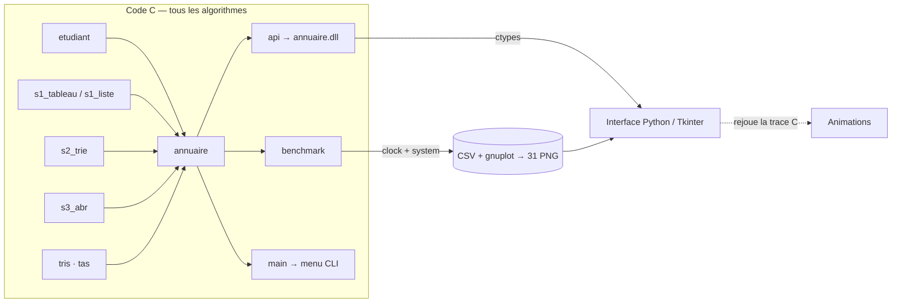

| Compilation | Options | Rôle |
|---|---|---|
| `annuaire.exe` | `-O2 -DSANS_INSTRUMENTATION` | menu + **étude expérimentale** — aucune ligne de trace dans le code mesuré |
| `annuaire.dll` | `-O2` + trace | bibliothèque de l'interface |
| `tests.exe` | `-DSUIVI_MEMOIRE` | détection des fuites et des écritures hors bornes |

**Règle d'or :** l'interface Python n'implémente **aucun** algorithme. Elle affiche.

---

## Une étude expérimentale rigoureuse

- **Tailles** n = 1 000 · 2 000 · 5 000 · 10 000 · 15 000 · 20 000, **3 simulations** par taille.
- **`clock()`** avec répétitions par lots jusqu'à **100 ms** de temps cumulé, puis moyenne.
- Jeux de données générés **hors chronométrage**, **identiques** pour toutes les structures : aléatoire, croissant, décroissant.
- **Copies hors chronométrage** pour les opérations destructrices (suppression).
- Meilleurs/pires cas **construits** (pas supposés) : ABR dégénéré vérifié (hauteur = n), 1ᵉʳ arrivé / moyenne absente pour S1, arrivées croissantes / décroissantes pour S2.
- Mesures brutes dans [`resultats/mesures_brutes.csv`](resultats/mesures_brutes.csv), un CSV par opération, protocole dans [`resultats/protocole.txt`](resultats/protocole.txt).
- Courbes tracées par **gnuplot lancé par `system()`** : plusieurs courbes par graphe, théorie ajustée par moindres carrés.

<div align="center">
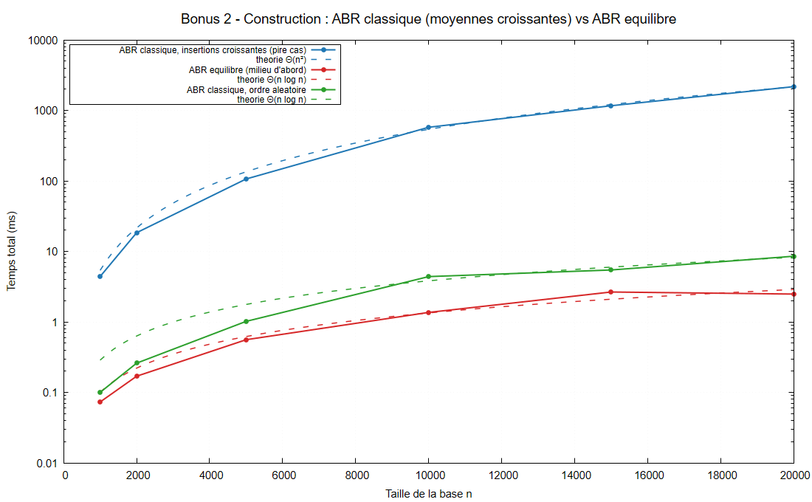 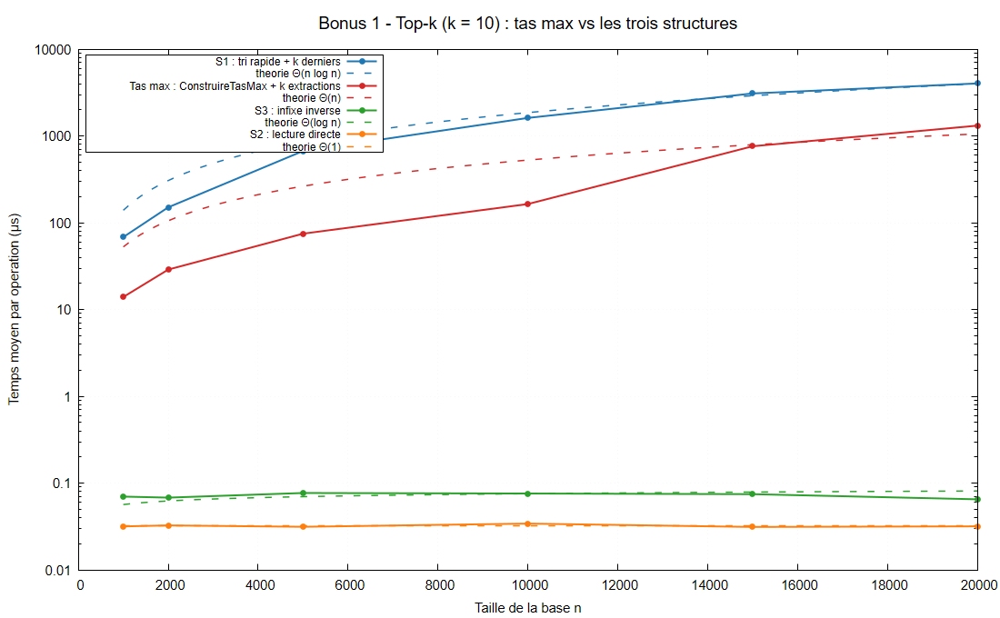
<br><sub>Bonus 2 : construction d'un ABR classique (Θ(n²)) vs équilibré · Bonus 1 : top-k, quatre méthodes.</sub>
</div>

---

## Des décisions de conception assumées (et défendables)

**Clé entière.** La moyenne est arrondie au centième et stockée aussi en entier (`cle = moyenne × 100`) : plus aucune comparaison de `float` avec `==`.

**Le piège des doublons.** Il n'existe que 2 001 moyennes possibles, et les moyennes de 5 notes se concentrent autour de 10 : à n = 20 000, une moyenne courante est partagée par des dizaines d'étudiants. Avec la règle naïve « égal → à droite » sur la seule moyenne, l'ABR « équilibré » de 20 000 étudiants atteignait une hauteur de **187 au lieu de 15**. La clé composée **(moyenne, matricule)** règle le problème : l'ABR n'a jamais deux clés égales, le comptage devient un parcours élagué Θ(h + d).

**Pas de récursion sur l'ABR.** Un peigne de 20 000 nœuds = 20 000 appels imbriqués = débordement de pile. Toutes les opérations sont itératives ; `detruire_arbre()` libère sans pile, par rotations.

**Tri rapide robuste.** Pivot médiane de trois par défaut ; récursion sur la plus petite partie → pile en O(log n) même dans le pire cas. La version à pivot fixe est conservée pour *montrer* l'effondrement.

**Des écarts à la théorie, mesurés et expliqués.** La recherche réussie dans S1 « plafonne » (effet des doublons) ; le parcours de l'ABR croît plus vite que Θ(n) quand les données sortent du cache. Le rapport (section 8) analyse ces écarts.

---

## Qualité et vérification

| Contrôle | Résultat |
|---|---|
| Vérifications automatiques | **12 733 / 12 733** |
| Fuites mémoire (bloc non libéré) | **0** |
| Écritures hors bornes (sentinelles) | **0** |
| `qsort` / `bsearch` | **aucun appel** |
| Opérations aléatoires comparées à un modèle de référence | 4 000 sur les 4 structures |
| Trois cas de suppression de l'ABR, doublons, tas, ABR dégénéré 20 000 nœuds | testés |
| Interface : 11 pages, chaque opération déclenchée | 0 erreur |

---

## Démarrage rapide

**Prérequis :** gcc · gnuplot · Python 3.10+ avec `matplotlib` (et `python-docx` pour le rapport).

```powershell
python -m pip install --user matplotlib python-docx
```

```powershell
.\build.bat
```

```powershell
.\build\tests.exe
```

```powershell
python gui\main.py
```

Autres commandes :

```powershell
.\build\annuaire.exe
```
*Menu en ligne de commande (16 entrées, version de secours sans interface).*

```powershell
.\build\annuaire.exe --bench --rapide
```
*Étude expérimentale rapide (~20 s). Sans `--rapide` : étude complète (~5 min).*

```powershell
python rapport\generer_rapport.py
```
*Régénère le rapport Word à partir des derniers CSV.*

> Sous Linux/macOS : `make`, puis `make test`, `make gui`, `make bench`.
> gnuplot est cherché dans le `PATH`, la variable `GNUPLOT`, puis les dossiers MSYS2 usuels.

---

## Organisation

```
├── src/                 code C : un module .c/.h par structure
│   ├── etudiant · s1_tableau · s1_liste · s2_trie · s3_abr
│   ├── tris · tas · annuaire · benchmark · main
│   └── api · instrument · memoire
├── tests/               tests de validation (suivi mémoire)
├── gui/                 interface Tkinter (backend ctypes, rejeu de trace, 11 pages)
├── resultats/           CSV des mesures + protocole
├── gnuplot/             scripts .gp générés
├── graphiques/          31 graphiques PNG
├── rapport/             rapport Word + PDF (10 pages) et son générateur
├── docs/                plan de démonstration (15 min) + captures
├── Makefile · build.bat
```

 **Livrables :** [rapport (PDF)](rapport/Rapport_MiniProjet_A.pdf) · [rapport (Word)](rapport/Rapport_MiniProjet_A.docx) · [plan de soutenance](docs/DEMONSTRATION.md)

---

## À retenir

- Pour **beaucoup d'ajouts** : **S1** (Θ(1), 0,05 µs).
- Pour **beaucoup de recherches, d'affichages triés ou de top-k** : **S2**.
- Pour une **base dynamique** (ajouts + suppressions + recherches) : **S3**, à condition d'éviter les insertions triées — ou de construire par le milieu.
- Pour un **top-k ponctuel sur données non triées** : le **tas max** bat le tri complet (×3 ici).

<div align="center">

*Chaque affirmation de ce README est tirée d'une mesure réelle présente dans `resultats/`.*

</div>
